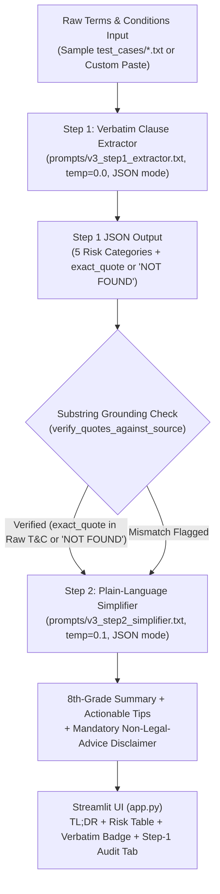

# ClauseWise AI — System Architecture (`v3_chained` 2-Step Pipeline)

This document illustrates the **2-step Prompt Chaining** architecture used in `v3_chained` to eliminate hallucinated clauses and ensure every consumer risk explanation is grounded verbatim in the source Terms & Conditions text.

---

## 1. Mermaid Flowchart



---

## 2. ASCII System Diagram

```text
+-------------------------------------------------------------------------+
|                       Raw Terms & Conditions Text                       |
|            (test_cases/*.txt or Custom User Input in app.py)            |
+------------------------------------+------------------------------------+
                                     |
                                     v
+-------------------------------------------------------------------------+
|                 STEP 1: Verbatim Clause Extractor (LLM)                 |
|  Prompt: prompts/v3_step1_extractor.txt | Model: gemini-3.5-flash-lite  |
|  - Audits 5 fixed categories (Data Privacy, Fees, Arbitration, IP, Acct)|
|  - Copies exact character-for-character quotes or outputs "NOT FOUND"   |
+------------------------------------+------------------------------------+
                                     |
                                     v
+-------------------------------------------------------------------------+
|                Substring Grounding & Verification Check                 |
|  Function: clausewise_core.verify_quotes_against_source()               |
|  - Checks: exact_quote in source_text (or exact_quote == "NOT FOUND")   |
|  - Prevents fabricated or paraphrased legal citations                   |
+------------------------------------+------------------------------------+
                                     |
                                     v
+-------------------------------------------------------------------------+
|               STEP 2: Plain-Language Simplifier + Guardrail             |
|  Prompt: prompts/v3_step2_simplifier.txt | Sees ONLY Step 1 JSON        |
|  - Translates verified clauses to 8th-grade reading level               |
|  - Adds actionable user tips + mandatory "NOT legal advice" disclaimer  |
+------------------------------------+------------------------------------+
                                     |
                                     v
+-------------------------------------------------------------------------+
|                        Streamlit Web UI (app.py)                        |
|  - Prominent Responsible-AI Legal Disclaimer Banner                     |
|  - (a) Plain-English TL;DR Summary                                      |
|  - (b) Risk Severity Table + Verbatim Match Badges (Verified/Mismatch)  |
|  - (c) Raw JSON & Step-1 Audit Tab                                      |
+-------------------------------------------------------------------------+
```

---

## 3. Why 2-Step Chaining (`v3`) Beats Single-Prompt (`v2`)

| Design Property | `v2_structured_risk` (Single Prompt) | `v3_chained` (2-Step Pipeline) |
| :--- | :--- | :--- |
| **Raw Text Exposure** | Summarizer sees raw T&C directly | Step 2 sees **only** Step 1's verified JSON |
| **Quote Fidelity** | Can paraphrase or alter punctuation (`80%`) | Grounded at `temp=0.0` before simplification (`100%`) |
| **Negative Control** | Over-flagged benign clauses as `Low` risk | Outputs `"NOT FOUND"` / `None` across all 5 categories |
| **Auditability** | Single opaque JSON response | Separate Step-1 Extraction Audit tab in `app.py` |
